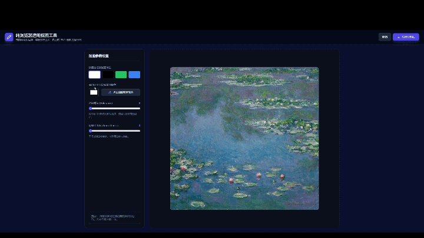

# Image Background Remover (透明背景导出工具)

一个轻量透明背景导出工具，完全在浏览器本地完成，数据不会离开您的设备。

## 核心功能
**背景擦除与透明导出**：支持采样色彩识别范围擦除，一键导出透明底 PNG 图像。

**实时参数微调**：提供容差（Tolerance）、边缘平滑度调整，即时预览抠图效果

## 快速访问
[点击这里打开在线工具](https://lizeluan.github.io/Image_Background_Remover/)

## 使用说明

### 简单示范

### 拉动滑块

### 文字使用说明：
1. 导入图片 
2. 默认会移除白色背景；更换其他颜色，可以先点击`点击画面吸管取色`按钮，然后点击要移除的背景颜色区域
3. 拉动滑块调整容差与羽化数值，预览去除背景颜色后的效果
4. 点击导出PNG按钮, 保存透明背景图片

## 功能解释
- **容差阈值**：控制颜色识别的严格程度
  - 数值调小（如 10 ~ 20）：只抠除和你用吸管点击的颜色极其相似的像素，边缘保留得更精确，但可能会在背景上留下一些杂色。
  - 数值调大（如 60 ~ 100）：连同与背景色相近的过渡色、阴影或光晕一起大面积擦除。如果背景不是很纯净（比如有阴影或渐变），增大容差可以把杂色擦得更干净。  
- **边缘平滑度 / 羽化值**：控制抠图边缘的过渡柔和度
  - 数值为 0：边缘是“硬切”的（像素非黑即白、非透明即不透明），抠出来的物体边缘可能会显得有锯齿或生硬。
  - 数值调大（如 10 ~ 20）：边缘会自动产生柔和的半透明过渡（羽化效果），让抠出来的物体和新背景融合时更自然、不生硬，特别适合处理头发丝边缘或有轻微模糊的物体。

